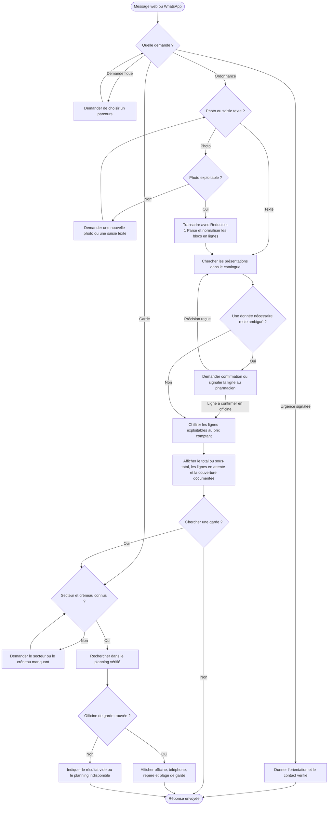

# Diagramme d’activités

Les deux activités peuvent démarrer de façon indépendante. Après une estimation, la personne peut enchaîner avec la garde.

Si aucune ligne n’a de prix comptant vérifié, la réponse indique que le montant est indisponible.
