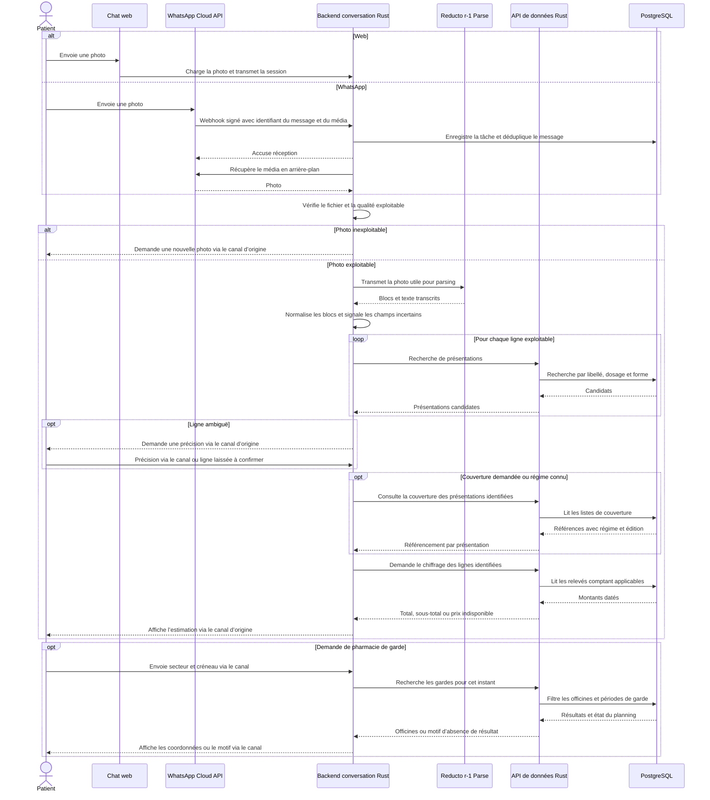

# Diagramme de séquence

Le scénario montre la lecture d’une ordonnance, puis une recherche de garde. Une demande de garde directe entre au dernier bloc.

Les interactions directes avec le patient après réception représentent les messages transmis par le chat web ou l’API Meta. Les lignes encore ambiguës restent visibles dans la réponse et hors du montant calculé.
